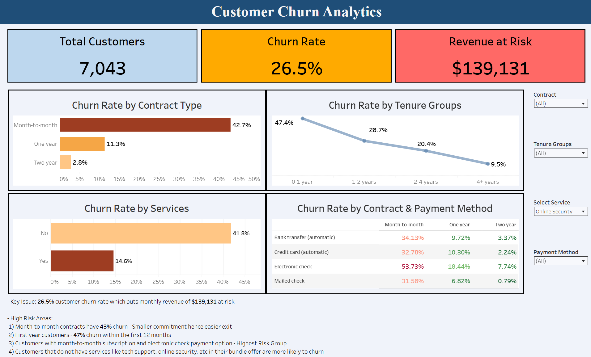

# Telco Customer Churn: Predictive Exploratory Data Analysis

### Executive Summary
This project develops an interactive dashboard to identify and quantify the primary drivers of customer attrition within the telecommunications sector. By analyzing a dataset of 7,043 customers, the dashboard isolates high-risk cohorts to inform data-driven retention strategies.

### Technical Stack
* **Visualization:** Tableau Desktop / Packaged Workbook (.twbx).
* **Analytical Approach:** Cohort Analysis, Feature Correlation, and Churn Risk Segmentation.
* **Data Source:** Telco Customer Churn (Standard industry benchmark dataset).

### Project Structure
Organized for reproducibility and professional review:
* **Data**: Contains the raw CSV source file.
* **Dashboard**: Contains the interactive Tableau (.twbx) file for full drill-down analysis.
* **Images**: Stores visual assets for documentation.

### Key Business Insights
* **Contractual Risk:** Identified that customers on month-to-month contracts exhibit the highest churn volatility (43%), suggesting a need for long-term incentive alignment.
* **New Customer Retention:** Retention of customers in the first year of their subscription is a major issue with 47% churn rate within the first year, suggesting a need to relook the initial subscription offerings.
* **Feature Bundling:** Customers without features like tech support, online security, etc in their bundle are more likely to churn than the ones with these features.
* **Payment Indicators:** Electronic check payments were identified as a leading indicator of attrition compared to automated bank transfers.
* **Highest Risk Group:** Customers on a month-to-month subscription with electronic check payment option was the highest risk group

### Dashboard Preview
